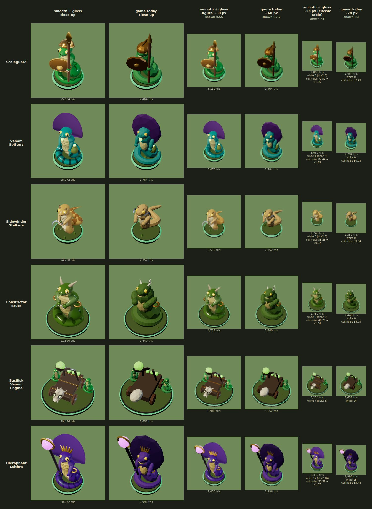
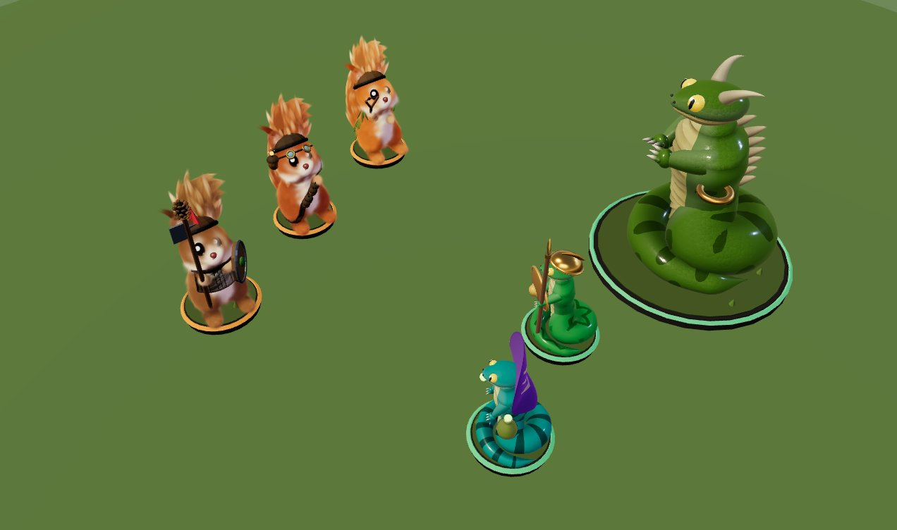

# Glossy Ssithra: the final prototype

The Coil of Ssithra's six figures made **smooth and shiny**: the glossy counterpart to the plush splat
Bushtails in `../splat/`. This is prototype A ("refined primitives + physical gloss", the one that won
on art, game-scale readability and engineering), finished with grafts from B (the sculpted basilisk
skull, three-claw hands) and C (crisp paint cut along a field's zero line, the screen-footprint gloss
level of detail, painted catchlights, the lavender shadow lift and the warm rim). Each figure keeps
`view/models/serpent.js`'s parts (a coil, a torso, a head, an optional hood, two arms, and the unit's
gear), its colours, its silhouette and its `userData.anim` (body, head, tongue, arms; the engine's wheels,
throwing arm and globe; the hierophant's gem) with the same `keep` marks. It is a look prototype: nothing
here is imported by the game, and `vite build` never sees it (only `index.html` is built), so `dist/` is
unchanged. (Prototypes A, B and C themselves aren't kept in the repo; this directory is the result.)





## See it

```sh
npm run dev -w packages/tails-and-scales
# then open /proto/scales/viewer.html?unit=hierophant
#   unit:    scaleguard, spitter, sidewinder, brute, engine, hierophant
#   mesh=1   the game's figure today (view/models/cache.js buildModel), for comparison
#   detail   the figure's level of detail: 1 close up (default), 0.5 for ~60 px, 0.3 for ~28 px
#   bake=1   merged by bake-gloss.js, as the game would bake it (it draws the same)
#   plain=1  every material swapped for kit.js's matte MeshStandardMaterial (the shapes without the gloss)
#   dpr      the pixel ratio when w is given (the gloss's level of detail is the same at 1 and 2)
#   mask=coil  the coil alone, white on black (what sheet.mjs measures the coil's noise inside)
#   w, h, dist, el, az, tx, ty, tz   canvas size and camera (el 44 is the table's camera, az 200 is
#            behind the figure, the player's view of their own army); drag to orbit
# and /proto/scales/pair.html          the two armies on one table (?game=1: at game scale)
```

The lights are view/stage.js's (and `../splat/viewer.js`'s): hemisphere `#d6e6ff`/`#3b2a1a` 0.85, sun
`#fff0d6` 2.3 from (-20, 40, 18), fill `#9fb8ff` 0.35 from (20, 15, -20), ACES at 1.05, background
`#708959`. The figure stands on kit.js's `base()`, lifted as cache.js lifts one (0.06; 0.09 for big units).

Everything below is shot and measured by one script (about two minutes under SwiftShader):

```sh
cd packages/tails-and-scales
CHROMIUM_PATH=/opt/pw-browsers/chromium-<build>/chrome-linux/chrome node proto/scales/sheet.mjs <out dir> [unit... | pair]
node proto/scales/bake-check.mjs      # bake-gloss.js against view/models/bake.js (Node, no browser)
```

`sheet.mjs` writes `units.png` (and `.jpg`: the copy above), `metrics.json`, a 600 px close-up of each
unit from the table's camera (`close-<unit>.png`) and from behind (`back-<unit>.png`), and the pairing
shots `pair.png` and `pair-small.png`.

## The files

| file | what it is |
| --- | --- |
| `serpents.js` | `buildSerpent(key, { detail })` → `{ group, triangles, ms }` for the six units: the naga body, its markings, hands, eyes and hood, the occlusion pass, and each unit's gear. The figure stands (coiled) on y 0, faces +z, has no base. No `Math.random` |
| `shapes.js` | smooth geometry: `body` (the swept body tube with its scuted belly and its markings cut crisply), `blob` (a sculpted icosphere, welded as it is built), `lathe` (welded as it is built), `horn`, `tint`, `vertexNormals`; `cutMesh`/`cutGeometry`/`cutPaint` (crisp paint along a field's zero line, optionally only in a region, its neighbours split at the cut's edge vertices so the surface stays closed); `occluder`/`occlude` (capsule occlusion) |
| `sdf.js` | signed-distance modelling for the engine's skull (graft of C's sdf.js: smooth min/max, rounded cone, ellipsoid, surface nets with an x-mirror, field occlusion) |
| `gloss.js` | the finishes: the HalfFloat environment, the scaled `skin`, the `belly` lacquer, `gloss`, `satinMetal`, `polished`, `glow`, all MeshPhysicalMaterial with one `onBeforeCompile` patch (scales, the env gate, the level of detail, the rim and the lift); `finishFields`/`classMaterial` for baking |
| `bake-gloss.js` | view/models/bake.js extended for the glossy figures (see "Baking"); `bake-check.mjs` proves it bakes the kit figures exactly as bake.js does |
| `viewer.html`, `viewer.js` | one figure, glossy or today's, on its base under the table's lights |
| `pair.html`, `pair.js` | three splat Bushtails facing three glossy Ssithra on one table, at the game's camera |
| `units.jpg`, `pair.jpg` | the sheet and the close pairing shot as of this commit |
| `sheet.mjs` | the comparison sheet, the measures, the close-ups and the pairing shots |
| `units.jpg` | the sheet as of this prototype |

## The approach

serpent.js builds a naga from about 15 flat-shaded primitives at roughness 0.72; their facets and the
joins between them are what made it look low-poly. Here every part is rebuilt smooth and the lacquer goes
on top.

- **One body, no joins.** Tail, coil, torso, shoulders and neck are one swept tube along one Catmull-Rom
  centreline (serpent.js's coil, or the sidewinder's S-curve, continuing up into the head). Its radius,
  belly flattening, width and belly width are interpolated between knots; its normals are analytic. The
  belly is its own mesh sharing the flank's vertices exactly: overlapping scutes in the geometry close up.
- **Shoulders filleted into the torso.** The tube broadens into a shoulder knot (1.5× wide) and slopes up
  into the neck, a trapezius; each arm's pivot sits inside that shoulder and its top is a low cap, so from
  behind there is one shoulder line and no ball on each side of the torso.
- **Hands.** The lathed arm tapers from the shoulder through the elbow to a wrist; the hand is a small palm
  with three claws (B's layout) curling forward, skin at the root and pale horn at the tip. The
  scaleguard's spear and shield and the hierophant's staff sit in them. The sidewinder's hands are
  **gripping hands** (`naga({ grip: true })`): each is turned a quarter about its forearm (thumb up) and
  its three claws, stacked up the grip, run out past the grip's far side and wrap back round it to the
  palm side, where their pale points show; the sickle's wooden grip runs through them along the hand's
  own axis. At the 28 px level the claws are left out (a hand is under a pixel there).
- **Markings cut crisply.** Each unit's pattern is a field over (s, θ, u) (arc length, angle round the
  body, fraction of its length): a viper's zigzag with flank blotches (scaleguard, the engine's crew),
  clean dark krait bands (spitter), diamonds (sidewinder), saddles with flank blotches (brute), chevrons
  (hierophant). The skin mesh's triangles are cut along each field's zero line (`shapes.js cutMesh`, C's
  `cut()` on parameters instead of a field in space), the crossing vertices doubled, so a mark's edge is a
  straight-sided curve at any ring spacing: no stair-steps. Every skin vertex also carries `plain`, its
  colour without markings, which the shader fades to on a small figure.
- **The hood's back: banding, not a face.** serpent.js's two belly-coloured discs high on a dark hood read
  as eyes from behind, and so did a cobra's spectacle (two loops and a bridge: glasses, and at 60 px two
  pale goggle lenses with a dark pupil in each). The hood's back now carries three nested chevrons
  pointing down the hood as its outline does (a king cobra's banding), each tapering along its arms,
  which curve up a little toward the edge; a thin line only 30% of the way from the hood's colour to the
  belly's. There is no pair of round marks anywhere on it, so neither close up nor at 60 px from behind
  does it make eyes. It is painted into the vertex colours, nothing inlaid, so nothing can z-fight. Each
  band lies between **two cuts**, along the chevron's signed distance minus and plus its half-width: each
  of those fields is smooth (linear but for the chevron's own corner), so even the 60 px level's coarse
  shell (icosphere detail 7) cuts a 2 px band crisply, where a `|distance| - w` field's thin valley falls
  between vertices and the band breaks up or fills in. All eight cuts (three bands, the extent ellipse,
  the back) are made only on the triangles near the mark (`cutPaint`'s `region`). A band's line runs on
  out of that region, so its cut splits edges that a triangle outside shares; `cutPaint` then splits
  those outside triangles at the same new vertices (`seal`: a fan from the opposite corner, or from a new
  centre vertex when more than one edge was split), so the shell stays closed. Left unsplit they were
  T-junctions, hairline cracks near the hood's upper rim that sparkled from behind (very likely the faint
  single pixels seen on the hierophant's hood at 60 px; none show now). Welded by position, the hood now has **0 open edges and
  0 T-junctions** at every level (it had 44/30 at detail 1 and 36/26 at 0.5), and the hood alone, flat
  white without MSAA on black, shows **0 crack pixels** over 40 views from behind at 300 px at detail 1,
  0.5 and 0.3, for the hierophant and the spitter (it was 10 and 18). At 28 px the hood is plain (the
  shader has faded markings there anyway).
- **The hood's finish.** It dims the env to about a fifth and softens its coat, so its back carries no
  broad window or horizon reflection (the "mouth" A showed); its rim sheen is thin (rr⁵) and in the
  hood's own purple (`uRimTint`), so the hood reads as its colour from behind and stays dark purple seen
  side-on (a pale lavender rim turned the whole shell lilac at grazing angles: a paper sail). The
  hierophant's hood is lifted from `#3a2060`-near-black to a readable purple.
- **Eyes.** 0.034 (serpent.js's 0.03), set into the head's surface so they bulge by two thirds, with a
  slit pupil and a painted white catchlight up and toward the sun from the pupil, both eyes alike, as the
  splat Bushtails' are.
- **The basilisk skull** (`serpents.js skullGeometry`, B's shapes in `sdf.js`): a flat-topped cranium and
  a low crest, a long flat snout, brow ridges over deep sockets, cheek arches, horns swept out and back
  from the temples, a lower jaw under a dark mouth line, four teeth a side and a pair of fangs, meshed by
  surface nets (normals from the field's gradient), its x ≥ 0 half only, then mirrored. Its sockets are
  painted dark to their rims and its hollows washed by the field's own occlusion, and the green eyes glow
  deep in them, so at 28 px it is two dark eyes and a jaw, not an egg.
- **Occlusion** (`shapes.js occluder`, M16): the body's own centreline as a chain of capsules, the head and
  the posed arms darken each other in the vertex colours: the coil's contacts, the armpits, under the chin.
  A capsule doesn't shade its own part, and the body doesn't shade itself within 2.6 radii along its length
  (that is curvature), but its next loop round does. The body samples it on a coarse (s, θ) grid (0.03 ×
  14 round) and each vertex reads it back; the head and arms vertex by vertex.
- **Gear.** serpent.js's gear, smoothed: a lathed helmet set high and tipped back so the eyes clear its
  brim; a satin-bronze shield (metalness 0.35, so it is lit by the sun instead of mirroring the dark table)
  with a domed boss; the sidewinder's dorsal ridges set along its actual back; horns and spikes darker at
  the root. The brute's dorsal spikes and its horns are **satin horn** (roughness 0.55, a light coat), the
  spikes a darker old horn (`#b9a679` at the tip) than the horns (`#d6c59a`): lacquered cream, they were a
  2 px near-white stripe down its back that flickered at the pixel spacing at 60 px from behind.
- **The brute's spikes sit on its back.** Seven spikes run up the middle of the back from y 0.40 to 0.70,
  each placed with `userData.spineAt(y)`: the tube's own surface point at θ = π (the spine) at that height
  and its normal there, found by bisecting along the centreline. Each is sunk 0.004 with its base flared
  below the surface, and raked back and up from that normal as today's are. serpent.js's fixed z (-0.135
  to -0.183) suited its straight cylinder torso; the tube's back comes forward from z -0.11 at the chest to
  -0.04 under the head, so at that z the upper spikes hung 0.1 to 0.15 behind it, a comb in the air seen
  from the side. The row stops below the head.
- **The sidewinder's sickles are in its fists.** Each is a short wooden grip through the gripping hand
  and a crescent blade (a tapering tube flattened into a blade, polished steel) from the grip's top end.
  The blade stands upright in the figure's frame whatever the forearm's tilt, leans 34° outward, arches
  over toward the front and hooks down to its point: a sickle's "?". The pair splays out either side of the
  chest, held up ready. Hung as serpent.js hangs them (`hold(arm, sickle, 0.4)`, which the previous round
  kept), they sat at the cheeks like tusks, the grip 0.07 behind the hand and the blade's arc centred 0.16
  above it, while the clawed hands hung empty below; along the forearm's own tilt they drooped like hooks;
  laid flat they read as a hoop.
- **The sidewinder rests on its base.** Its S-curve is written where it should end up and turned back by
  the body's 0.12 lean (serpent.js's lean lifted its front off the base); its last bend comes round under
  the chest before it rises, its tail lifts a little behind as serpent.js's does, and its pale belly is a
  narrower stripe up the rise, so the S-curve reads as one stroke.
- **The engine's crew** are built at their final 0.72 size (`foldScale`: every offset and geometry scaled,
  no scale on the group) with the skin's scale frequency divided by 0.72, so baked or not their scales are
  a standalone scaleguard's size (bake-check: ×0.999 scales per figure). One crew is built, the other is
  its clone, and the crew carries **no userData** (it is a part of the machine; nothing animates it):
  Object3D.clone copies userData through JSON, and each arm's `hand` (an Object3D) was serialised whole,
  geometry, materials and env map, ~20 ms per engine build and a 0.75 MB blob left in each cloned arm,
  which cache.js then deep-copied for every engine placed (7-9 ms; now 0.5 ms).

## The finish (`gloss.js`)

- **Lacquered skin, not glass or jelly.** A coil read as glass, and the brute's as a jar of green jelly,
  when a dim, broad reflection lay over darker markings it didn't follow: the horizon band and the window
  panel mirrored across a broad, gently curved coil (a milky veil, a concentric ring) and a pale rim at its
  silhouette. Now:
  - the env reaches the skin's base at 0.35 and its coat at 0.30 (`uEnvSpec`, `uEnvCoat`), and is
    **gated by its own brightness** (`sGate`, `uEnvFloor` 0.1 below `uEnvKnee` 3, full above twice
    that): the hot spots (the sun, the window's core) reflect, the dim dome, horizon band and table only
    at a tenth. A lacquer shows its light sources and its colour;
  - the base layer's own specular is 0.3 (from 0.6): the coat is the gloss; a broad base sheen over the
    paint is what reads as glass;
  - the coat is a touch soft (0.13) and follows the scales' normals 70% of the way (`uCoatFollow`), so what
    it reflects is broken up by the scales it lies on; it hides the base only as much as it reflects (three
    hides it by the full Fresnel term, which with a dimmed reflection turned every grazing edge dark: a
    bottle-glass outline);
  - the warm rim is thinner (rr⁴) and 60% in the skin's own hue (`uRimTint`), so it brightens the colour
    at the silhouette instead of fringing it pale;
  - the base is ~18% more saturated, and the clearcoat stays at 1.

  The brute's coil from behind (the same pixels of `back-brute.png`) went from a mean HSL saturation of
  0.48 to 0.73, and in the pair shot from 0.50 to 0.67; its saddles are painted on, not seen through a
  shell.
- **Scales** from object-space position and normal (a jittered 3D Voronoi, 27 cells, at 52 a unit; no
  UVs), each domed and keeled, washed darker at the seams. The hash is Dave Hoskins' fract-based one, not
  sin-based. They fade out by their own pixel size and with the figure's footprint.
- **The environment** is a 256×128 equirect built on the CPU as **HalfFloatType**
  (`THREE.DataUtils.toHalfFloat`): linearly filterable on every WebGL2 device, no float-linear extension
  needed. A dim dome, a bright horizon band, a warm window panel, a cool rim panel and a small hot sun.
  Metal (`polished`) reflects all of it ungated: the horizon line is what makes brass read as metal.
- **The Bushtails' light.** Under the strongest directional light, the shadow side keeps 35% of the key
  light tinted the splat's lavender `(0.40, 0.32, 0.58)`, and a warm rim `(1, 0.86, 0.66)` (softer on a
  small figure): the two terms that make plush fur and enamel look lit by one hand (see `pair.png`).

### The level of detail: screen footprint, not distance

C's `tgSmall`, computed per vertex: the figure's own units per CSS pixel at that depth,
`2·depth / (P[1][1] · viewportHeight / pixelRatio · figureScale)`. Dividing by the pixel ratio makes it
the same at DPR 1 and 2 (the sheet checks: `dpr2` below); dividing by the figure's scale (its model
matrix, which carries only that: every part's own scale is folded into its geometry) makes a 2.15× brute
and a scaleguard of the same height on screen get the same treatment. It runs 0 (close up, below 0.009
units/px) to 1 (about 28 px, 0.03 units/px). As it rises:

- the coat's roughness rises to 0.42 and its strength falls by 35%; the base's roughness rises to 0.62;
- the env and window reflections dim by 75%;
- the markings fade 90% of the way to the plain skin, and the scales fade out entirely;
- the rim softens by 60%.

At 28 px a figure shows one soft highlight and no glints.

## Measures (`sheet.mjs`, `metrics.json`)

At 28 px from the table's camera, against today's mesh figure in the same pixels:

| unit | near-white px (today) | at DPR 2 | coil noise (today) | ratio |
| --- | ---: | ---: | ---: | ---: |
| scaleguard | 0 (0) | 0 | 72.5 (57.5) | 1.26 |
| spitter | 1 (0) | 2 | 82.4 (50.0) | 1.65 |
| sidewinder | 0 (0) | 0 | 55.3 (59.8) | 0.92 |
| brute | 0 (0) | 0 | 40.2 (38.8) | **1.04** |
| engine | 7 (14) | 5 | — | — |
| hierophant | 17 (18) | 16 | 59.5 (55.4) | 1.07 |

Near-white is every channel ≥ 170 of 255; at most today's +1 for every unit (the spitter's is its venom
bead's glow; the engine's and hierophant's are the skull and the gem, today's too). The coil noise is the
mean |Laplacian| of luminance inside the coil (`viewer.html?mask=coil`, shrunk a pixel off its silhouette):
the brute's coil is 1.04× today's. The scaleguard's zigzag and the spitter's krait bands keep some of their
contrast at 28 px (that is the units' identity), so their coils are 1.26× and 1.65× today's flat ones.

From behind (az 200 and 180, el 44, the sheet's framing), the brute's near-white pixels are 10 and 11 at
60 px with its spikes now on its back, against today's mesh's 13 and 9 in the same shots (round 1 had 39
and 38, its lacquered cream spikes), and 1 and 0 at 28 px. The sidewinder's sickles are polished steel and
add 6 near-white pixels at 60 px from the table's camera (12 with them, 6 without; today's figure has 1), a
glint along each blade; at 28 px it has none, with or without them.

## Numbers

Triangles per figure, and build time in milliseconds: **cold** in headless Chromium (a fresh page per
build, as the sheet does, so every build pays V8's warm-up: the median of 10 builds at detail 1 and of 5
at the others, and the worst of them) and **warm** in Node (the median of 9 after two passes). Times are
for the figure alone (today's include its base and bake).

| unit | detail 1 (close up) | detail 0.5 (~60 px) | detail 0.3 (~28 px) | today | 0.3 ÷ today |
| --- | --- | --- | --- | ---: | ---: |
| scaleguard | 25,604 · 110 (max 208) / 26 | 5,130 · 43 / 7 | 2,808 · 37 / 6 | 2,464 | 1.14 |
| spitter | 28,072 · 114 (max 127) / 25 | 6,470 · 64 / 10 | 3,060 · 37 / 7 | 2,784 | 1.10 |
| sidewinder | 24,280 · 80 (max 96) / 20 | 5,510 · 44 / 6 | 2,740 · 40 / 5 | 2,352 | 1.16 |
| brute | 21,696 · 84 (max 108) / 23 | 4,712 · 46 / 9 | 2,759 · 44 / 10 | 2,440 | 1.13 |
| engine (with crew) | 19,456 · 102 (max 115) / 33 | 8,986 · 77 / 15 | 6,254 · 68 / 12 | 5,652 | 1.11 |
| hierophant | 30,972 · 122 (max 133) / 35 | 7,050 · 60 / 10 | 3,339 · 44 / 5 | 2,996 | 1.11 |

(cold Chromium median (worst) / warm Node median.) The machine was noisy when these were taken: a second
full run gave detail-1 medians of 89 (scaleguard), 120, 89, 90, 111 and 140 ms (hierophant), and the
scaleguard, whose code didn't change in the last round, ran 87 ms in the round before. The last round's
changes cost nothing measurable: the hood's `seal` (warm 30 against 29 ms without it on the hierophant;
cold medians within each other's run-to-run spread), the brute's seven spine lookups and the sidewinder's
gripping claws and swept blades (both within their earlier times). The final sheet's own cells,
one cold build each, came in at 83–137 ms at detail 1, and its 600 px shots at 77–112 ms. Round 1 had the engine at 147–184 ms
cold (75 warm) and the nagas at 86–135. What brought them down, all deterministic and the same geometry:
the crew cloned without userData (−20 ms on the engine), the skull meshed for its symmetric half and
mirrored, every `lathe` welded as it is built instead of by three's string-hashing `mergeVertices` (−30 ms
on the hierophant, whose five crown spikes were five lathes; now one), smooth normals in plain array
arithmetic, the hood's cuts made only where its marks are, unmarked vertices painted once, and the body's
occlusion grid a little coarser. A figure is built once per unit type and cloned by cache.js, so this is
per unit type per session, not per figure. At detail 0.3 every unit is within 1.2× today's triangles: the
floor comes from the low-detail head (an icosphere of detail 4), hood (4, unmarked), a coarse body tube,
no claws, nostrils or catchlights, rounded octahedra of detail 0, a skull at a 0.042 cell.

## Baking (`bake-gloss.js`)

bake.js merges a figure into one mesh per material class (position, normal and one colour per part) and
draws each class with a MeshStandardMaterial. `bake-gloss.js` is bake.js with three changes, each a no-op
for the kit's plain parts:

1. **classKey keeps every old field** (metalness, roughness, emissive, its intensity, transparent,
   opacity, side, flatShading) and, for a glossy part only, appends gloss.js's physical fields (type,
   clearcoat and its roughness, specular, iridescence, env intensity) and its shader parameters;
2. **a part's own vertex colours are read only when its material has `vertexColors` on** (times its
   material colour, flipped with their corners on a mirrored part); a skin part also carries `plain`;
3. **a glossy class is drawn with `gloss.js classMaterial`** (the same MeshPhysicalMaterial, env and
   patch, its colour moved into the vertices); a plain class with bake.js's own MeshStandardMaterial.

`node proto/scales/bake-check.mjs` builds every squirrel figure (view/models/squirrel.js) and every serpent
figure today twice, bakes one with each, and compares them node for node: every one is **the same**
(children, places, every attribute array value for value, material class and fields). It then bakes each
glossy figure and checks every triangle, the skin's own colours and its plain colour survive, and that the
engine's baked crew has a standalone scaleguard's scales per figure. `viewer.html?bake=1` draws the same
as the unbaked figure. The shader reads only object-space position and normal (and `plain`), which baking
carries in the figure's space. A baked figure is 6–10 meshes (19–20 for the engine, with its kept wheels,
arm and globe), against today's 3–4 (15).

## Integrating it into the game

- view/models/bake.js takes `bake-gloss.js`'s three changes; cache.js needs nothing new (its far
  stand-in already reads vertex colours times the material colour, and its clone sets userData aside);
  the kits route `serpent` to `serpents.js`, with `detail` chosen from the board size. The `anim`
  structure is serpent.js's, so view/units.js's sway, head bob and tongue work unchanged.
- view/stage.js sets no `scene.environment`, and doesn't need to: each glossy material carries `ENV`.
- The level of detail needs nothing from the game: it reads the viewport and pixel ratio from the renderer
  each draw (`material.onBeforeRender`).

## The pairing (`pair.png`, `pair-small.png`)

Three splat Bushtails (nutkin, grenadier, oakguard: `../splat/bushtail-kit.js`, each splat mesh sorted for
the camera before every draw) face three glossy Ssithra (brute, scaleguard, spitter) about 3 units apart,
each line turned a little toward the game's camera (fov 40, 44° up), close (~136 px figures, every splat,
detail 1) and at game scale (~34 px, the splats the game would draw there, detail 0.3). The lavender lift
and the warm rim are what tie the two finishes: fur and enamel share their shadow colour and their edge
light (warm on the fur, warm and in its own hue on the enamel), and the enamel's crisp highlights are the
only thing the fur doesn't have.

## What's left

- The hood's chevrons are a design choice, not a cobra's real spectacle: a spectacle is a pair of eyeglasses
  by its nature, and from behind, the player's default view, it read as a face at every size. If a
  spectacle is wanted back, put it on the hood's front (the side the enemy sees).
- The arm and the shoulder are separate meshes: the shoulder is filleted by the tube broadening around the
  arm's top, but close up a crease shows where the upper arm leaves it (no smooth union as in B and C).
- Occlusion is computed once at build time with the arms in their pose; arms that animate after baking
  would carry it with them (they are baked into the figure today, so they don't).
- Cold builds are 80–122 ms at the median (89–140 in a second run on a noisy machine), and a single build
  can reach 150–240 ms on an unlucky run (GC, V8 tiering: the unchanged scaleguard and engine too); a
  cache of each unit's geometry per detail, or building figures off the main thread, would hide that.
- The sidewinder's polished blades glint: 6 near-white pixels at 60 px from the table's camera (none at
  28 px). If they flicker in motion, a satin steel at the 60 px level would quiet them.
- Only the sidewinder has gripping hands. The scaleguard's spear and the hierophant's staff still pass
  through open, forward-curling claws, which reads as held at game scale; `naga({ grip: true })` and a
  grip along the hand's axis would close those fists too.
- Not yet seen with the stage's shadow map, animation, or a full army on the table; measure a Grand battle
  before turning it on (MeshPhysicalMaterial with clearcoat, plus up to 27 cell lookups where scales are
  visible, skipped where they aren't).
