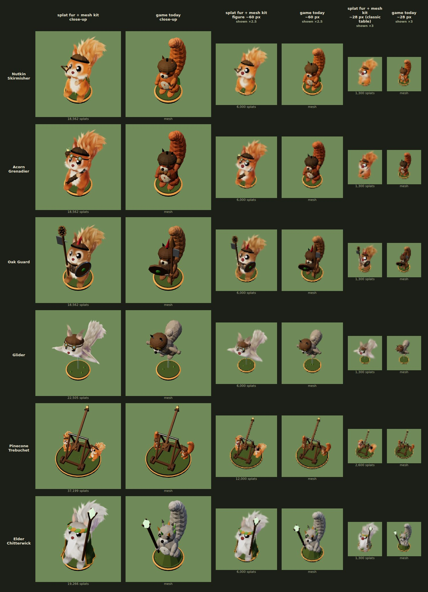

# Splat Bushtail — a prototype

The Bushtail Clans' six figures with their fur drawn as 3D Gaussian splats and
everything they wear or carry modelled as meshes, in three.js beside the
game's own meshes. It is a look prototype: nothing here is imported by the
game, and `vite build` never sees it (only `index.html` is built), so `dist/`
is unchanged by it.



## See it

```sh
npm run dev -w packages/tails-and-scales
# then open /proto/splat/viewer.html?unit=elder   (nutkin, grenadier, oakguard, glider, trebuchet, elder)
#      add &mesh=1 for the game's mesh figure today; drag to orbit
```

The comparison sheet (each unit close up, then at about 60 and 28 px, beside
today's mesh at the same sizes):

```sh
cd packages/tails-and-scales
CHROMIUM_PATH=/opt/pw-browsers/chromium-<build>/chrome-linux/chrome node proto/splat/sheet.mjs <out dir> [unit...]
```

It writes `units.png` (and `units.jpg`, the copy shown above) to the out dir.

## The files

| file | what it is |
| --- | --- |
| `upstream-squirrel.js` | the splat-squirrel project's `src/squirrel.js`, as it came: a procedural cartoon squirrel of about 81,000 splats on a 24-bone rig |
| `make-bushtail.py` | turns it into `bushtail.js` by anchored edits (each must match once) |
| `bushtail.js` | **generated** (`python3 make-bushtail.py`): the fur alone, in any unit's palette, with the Elder's beard and the Glider's membrane as splat stages; poses; a progressive splat order; the rig's anchors and the body's surface for fitting kit |
| `splat-three.js` | splats in three.js: `bakeSplats` skins a posed model once on the CPU, `SplatMesh` draws it among the meshes (depth-tested, back to front, three's tone mapping) |
| `bushtail-kit.js` | the six units: each one's coat, pose and mesh kit, built with the game's `view/models/kit.js` |
| `viewer.html`, `viewer.js` | one figure, splat or mesh, on its base under the table's lights |
| `sheet.mjs` | the comparison sheet |
| `units.jpg` | the sheet as of this commit |

## What was decided along the way

- **Splats for fur only.** Hats, goggles, straps, armour, weapons, the robe
  and the trebuchet are meshes; the beard and the gliding membrane are fur,
  so they are splats.
- **Few, big splats.** A splat scale of 1.5 with fewer splats reads best.
  A squirrel is about 18,500 splats at density 0.2 for close-ups; the game
  would draw `n ≈ 1.7 × (figure height in px)²` of its progressive order
  (at least 800, all of them from about 90 px): about 6,000 at 60 px and
  1,300 on the classic table (28 px).
- **The face reads from above.** Bigger eyes, the head tilted up 0.3 rad and
  scaled 1.1 so the face shows to the game's 44° camera; the face's parts
  come first in the progressive order, so they thin last.
- **Kit fitted to the body.** Straps, the breastplate and the robe are cast
  onto the splat body's own surface (its SDF, without the arms) and stand
  off it by the fur's depth; held things sit in the posed paws.

## Not done

- Not in the game: no `?splat` switch, no far stand-in, no shadows from the
  fur (it would need a proxy, e.g. today's mesh, drawn to the shadow map only).
- No ink outline (the upstream renderer has one; three.js would need a pass).
- Figures don't animate their limbs; the game's whole-figure hop, breath and
  lean would apply to the group.
